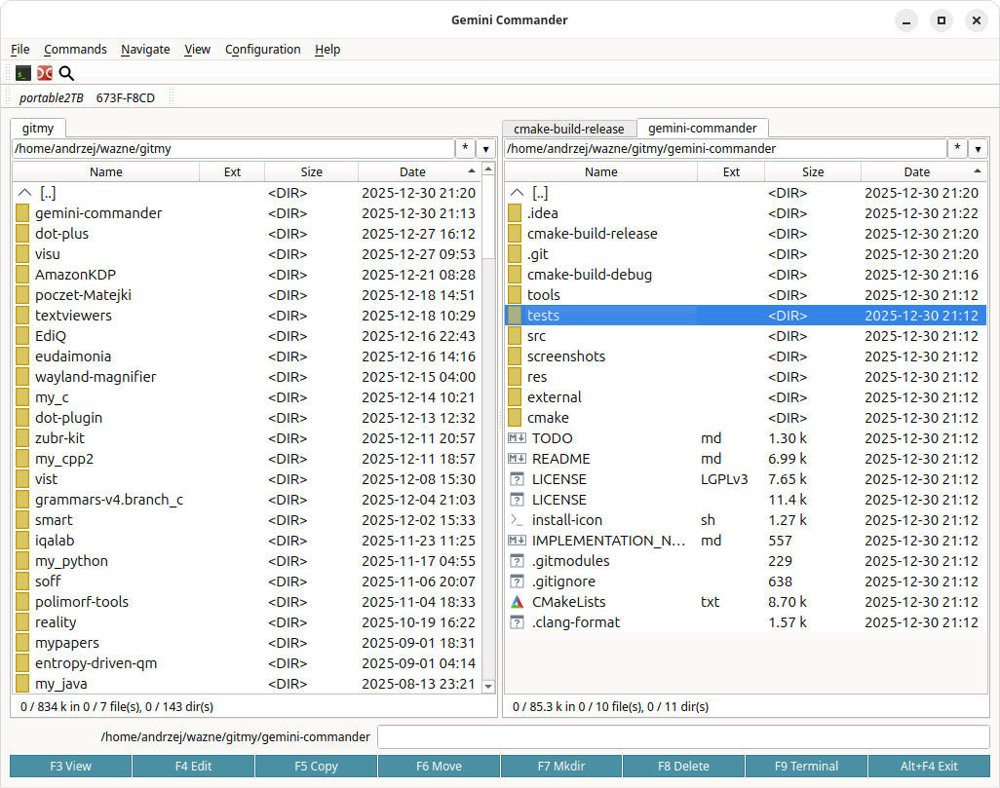

# Gemini Commander
Twin-panel file manager written in C++ with the Qt library.
```shell
git clone https://github.com/siplasplas/gemini-commander
```

<p align="center">
  <a href="screenshots/main-window.png">
    
  </a><br>
  <em>Dual-pane file manager built with Qt6</em>
</p>

## Features

- **Hidden file search** — Incremental search handles dot-prefixed files naturally (e.g., typing "git" finds ".gitignore")
- **Built-in editor and viewer** — Opens instantly on top of the main window, even on Wayland where window stacking can be problematic. The editor window is [QCEditor](https://github.com/siplasplas/qceditor)'s editor library (the same editor, its settings kept in Gemini Commander's configuration), on the [qcodeedit](https://github.com/siplasplas/qcodeedit) widget with Kate syntax definitions, folding, a slightly darker background (lighter on dark themes) on the line with the caret, an inline find/replace bar (regular expressions, whole words, in selection), go to line:column (with this session's recent positions) and recent files. A file changed on disk is reloaded as one undo step (Ctrl+Z brings back the text before it); one with unsaved edits is left as it is, unless **Tools > Ask to Reload Modified Files** is on. Files named `*.een` are encrypted on disk: the editor asks for the password and reads the formats of the earlier editors EdiQ and Editas, saving in EdiQ's (see QCEditor's README); the viewer shows them as they are on disk. The status bar shows line:column (in characters: an emoji is one column), the Unicode code point of the character after the caret (e.g. U+0105), the line breaks (Unix LF, Windows CRLF, Mac CR or Mixed), the encoding, the text's language (detected in the background, so opening is not slowed down) and the tab width. Files open in their own encoding (UTF-8/16/32 or a legacy code page such as cp1250, ISO 8859-2 or cp852, detected automatically) and are saved in it with their line breaks; characters the code page cannot store ask whether to write `?` or switch the file to UTF-8, and **Encoding** in the context menu reopens or saves the file in another encoding
- **Find Files (Alt+F7)** — Several name masks separated by `;` (e.g. `*.cpp;*.h`), text content, size and modification date range. **Skip during search** on the Advanced tab lists directory and file names to skip (with `*` and `?`, e.g. `.git;cmake-build*` and `*.o`; skipped directories are not entered) and can skip what `.gitignore` files ignore, read from the search directory down and, inside a git work tree, also from its top (deeper files add rules, `!` includes again); these settings are saved. **Clear** resets the search options and clears the results
- **Copy without ignored files** — Copying a directory or several entries (F5, Shift+F5) can skip what `.gitignore` files ignore, read from the source directory down exactly as in Find Files; the checkbox is remembered. **Count** in the copy dialog shows the number and total size of the files to copy (in the background); the copy then uses that count instead of counting again, and OK pressed while counting starts the copy when the count is done
- **Show filters** — In the Show menu, for the current panel: **All Files** (Ctrl+F10) shows everything again, **Programs** (Ctrl+F11) shows directories and executables (Linux: files executable by the user; Windows: `.exe`, `.com`, `.bat`, `.cmd`, `.ps1`), **Custom** (Ctrl+F12) shows the files matching masks such as `*.cpp;*.h` and/or hides what `.gitignore` files ignore, files and directories, as Find Files and Copy do. Two options, shown and saved once for the Custom filter, Copy and Find Files alike, set where `.gitignore` files start counting above the directory — the nearest directory with `.git` (the git repository), or the highest directory with a `.gitignore` below home (one `.gitignore` for a group of repositories, e.g. to copy them to a USB drive) — and whether `.git` directories are hidden as well. The branch view (Ctrl+B) and directory sizes (Space, Alt+Shift+Enter) follow the filter, so e.g. with `*.cpp;*.h` and `.gitignore` the sizes show which directories hold the most sources, without build directories. An active filter is shown after the path above the panel, e.g. `/home/user/project/[*.cpp;*.h;!gitignore]` or `[programs]` (`!gitignore`: without what `.gitignore` ignores); while the path is edited it is a plain path
- **Drag and drop** — Drag files from panels to other applications
- **Command line path insertion** — Like Total Commander: Ctrl+Enter inserts current file path, Ctrl+Shift+Enter inserts full path, Ctrl+P inserts current directory. Unlike Double Commander, arrow keys immediately select text in the command line for quick keyboard-only copying
- **Safe USB copying** — Every copied file is synced to disk with fsync(), preventing data loss when unmounting USB drives
- **Smart directory/file navigation** — Ctrl+Down jumps to the first file (skipping directories), Ctrl+Up jumps to the last directory (from bottom)
- **Smart mount filtering** — Intelligent filtering of block devices and mounted directories, hiding system internals (ZFS pools like bpool/rpool, swap, tmpfs, snap mounts) while showing user-relevant mounts like USB drives, ISOs, and VirtualBox shares

## License

The source code of this project ([Project Name, e.g., Gemini Commander]) is made available under the terms of the **Apache License 2.0**. The full text of the license can be found in the `LICENSE` file in the repository's root directory.

### Qt Dependency and LGPLv3 License

This project uses the **Qt** framework ([https://www.qt.io/](https://www.qt.io/)) for building the user interface and other functionalities.

Key licensing assumptions regarding the use of Qt in this project:

1.  **LGPLv3 Module Usage:** The project aims to exclusively use Qt modules available under the **GNU Lesser General Public License version 3 (LGPLv3)**. The full text of this license can be found in the `LICENSE.LGPLv3` file (or similar) in the repository.
2.  **GPLv3 Module Restriction:** To maintain Apache 2.0 license compliance for the project's code, Qt modules available **exclusively** under the **GNU General Public License (GPL)** (e.g., historically modules like Qt Charts, Qt Data Visualization - the current list and module licenses should be checked in the Qt documentation for the version used) **cannot** be used. Using a GPL-licensed module would require relicensing the **entire** project under the GPL or a compatible license.
3.  **Dynamic Linking:** The application **must be linked dynamically** with the Qt libraries. This is an LGPLv3 requirement that allows end-users to replace the Qt libraries used by the application with other compatible versions (e.g., versions modified by them in accordance with LGPLv3).
4.  **Information for Users and Distributors:**
    * If you distribute a **compiled version** of this application, you must comply with the LGPLv3 requirements, including:
        * Informing users that the application uses Qt under the LGPLv3.
        * Providing users with the text of the LGPLv3 license.
        * Providing a mechanism to allow replacement of the Qt libraries (ensured by dynamic linking).
        * Indicating where to obtain the source code of the Qt version used.
    * If you distribute **only the source code**, you must still:
        * Inform about the use of Qt and the LGPLv3 license.
        * Include the text of the LGPLv3 license.
        * Indicate the source of the Qt code.
        * Specify the required Qt version.

The editor widget comes from [qcodeedit](https://github.com/siplasplas/qcodeedit) (LGPL-3.0-or-later)
and the shared widgets from [qt-extra](https://github.com/siplasplas/qt-extra) (LGPL-2.1); both are
fetched by CMake and linked statically. Since the complete source of Gemini Commander is available,
users can rebuild it with modified versions of these libraries, as the LGPL requires.

**In summary:** Your contributions to this project are licensed under Apache 2.0. However, because the project uses Qt libraries under the LGPLv3, the work as a whole (especially in binary form) is also subject to the terms of the LGPLv3 concerning the Qt parts. Users have rights and obligations stemming from both licenses, applicable to the respective components of the project.

## Prerequisites
Gemini Commander needs only **Qt6** (6.2 or later) — no KDE Frameworks and no Qt5 —
plus a few small libraries. CMake 3.24 or later is required.

On Ubuntu 24.04 LTS/25.10, Mint 22, Debian, Pop!_OS
```
sudo apt update
sudo apt install git cmake g++ pkg-config qt6-base-dev libbotan-2-dev \
    libicu-dev nlohmann-json3-dev libarchive-dev libgtest-dev librsvg2-bin \
    libhunspell-dev hunspell-en-us hunspell-pl
```

On Fedora/RHEL-based systems:
```
sudo dnf install git cmake gcc-c++ pkgconf-pkg-config qt6-qtbase-devel botan2-devel \
    libicu-devel json-devel libarchive-devel gtest-devel librsvg2 librsvg2-tools \
    hunspell-devel hunspell-en-US hunspell-pl
```

On Arch-based systems (e.g., Arch Linux, Manjaro):
```
sudo pacman -Syu git cmake pkgconf qt6-base botan \
    icu nlohmann-json libarchive gtest librsvg hunspell hunspell-en_us hunspell-pl
```

On openSUSE:
```
sudo zypper install git cmake gcc-c++ pkgconf-pkg-config qt6-base-devel libbotan-devel \
    libicu-devel nlohmann_json-devel libarchive-devel gtest rsvg-convert \
    hunspell-devel myspell-en_US myspell-pl_PL
```

On Windows (using MSYS2 or Chocolatey; note that KDE development on Windows may require additional setup):
(note: on Windows not works yet)
```
pacman -S git
git config --global core.autocrlf true # for IDE like CLion
pacman -S mingw-w64-ucrt-x86_64-cmake
pacman -S mingw-w64-ucrt-x86_64-gcc
pacman -S mingw-w64-ucrt-x86_64-gdb
pacman -S mingw-w64-ucrt-x86_64-gettext-tools
pacman -S mingw-w64-ucrt-x86_64-ninja
pacman -S mingw-w64-ucrt-x86_64-qt6-base
pacman -S mingw-w64-ucrt-x86_64-libbotan
pacman -S mingw-w64-ucrt-x86_64-nlohmann-json
pacman -S libarchive
pacman -S mingw-w64-ucrt-x86_64-gtest
pacman -S mingw-w64-ucrt-x86_64-hunspell
```

### Libraries fetched by CMake

These libraries do not have to be installed; CMake's FetchContent downloads
the pinned version during configuration and builds it into Gemini Commander.
If a suitable version is already installed, it is used instead:

| Library | Used for | Installed version used if |
|---------|----------|---------------------------|
| [qt-extra](https://github.com/siplasplas/qt-extra) | `MruTabWidget`, `QxFileDialog` | `find_package(qt-extra 2.7)` |
| [qceditor](https://github.com/siplasplas/qceditor) | the editor window and the viewer of small files (its editor library, the same as QCEditor's), encrypted `.een` files (with Botan) | `find_package(qceditor 1.13.0)` |
| [qcodeedit](https://github.com/siplasplas/qcodeedit) | editor widget, Kate syntax highlighting, syntax downloader, file encodings (with [cpg](https://github.com/siplasplas/cpg)), reloads as an undo step | `find_package(qcodeedit-katedata 1.30.0)`, `qcodeedit-encoding`, `qcodeedit-spell` (needs libhunspell-dev), `qcodeedit-spelldata` and `qcodeedit-diff` |
| [toml++](https://github.com/marzer/tomlplusplus) | configuration files | `find_package(tomlplusplus 3)` |
| [textviewers](https://github.com/ideorg/textviewers) | viewer for large files | always fetched |
| [backward-cpp](https://github.com/bombela/backward-cpp) | crash stack traces | always fetched |

For libraries installed outside the default search paths, pass
`-DCMAKE_PREFIX_PATH=/path/to/prefix`. To always use the fetched versions,
pass `-DFETCHCONTENT_TRY_FIND_PACKAGE_MODE=NEVER -DCMAKE_DISABLE_FIND_PACKAGE_qcodeedit-katedata=ON`.
To build with a local qcodeedit checkout (e.g. uncommitted changes), pass
`-DFETCHCONTENT_SOURCE_DIR_QCODEEDIT=/path/to/qcodeedit`; the installed qcodeedit
packages are then not used.

### Syntax definitions

The editor highlights files with Kate syntax definitions and color themes. They
are not part of the program: when the editor is opened the first time it offers
to download them from kate-editor.org (**Tools > Update Syntax Definitions**
downloads or updates them later). They are stored in
`~/.local/share/kate-data/<version>/`, a place shared with other programs that
read Kate data (deliberately not under `siplasplas`). Without them, only C/C++
files are highlighted (built-in rules).
The **Default** theme is Breeze Light, or Breeze Dark on a dark desktop; before
the themes are downloaded the editor shows black text on white.

### Where Gemini Commander keeps its files

The configuration (`config.toml`: favourites, toolbars, panels and the other
settings) is in `~/.config/siplasplas/gemini-commander/`, like the other
siplasplas programs; data would go to `~/.local/share/siplasplas/gemini-commander/`.
Older versions' files are moved once at start-up (qt-extra's
`qxMigrateToSiplasplas()`): `~/.config/gemini-commander/config.toml`, recognized
by its tables, and the emptied `~/.config/gemini-commander` is removed; files
there that Gemini Commander does not recognize are moved only when you agree.
`~/.config/gemini-commanderrc`, the settings of the former KTextEditor-based
editor, is removed. Kate data from `~/.local/share/qcodeedit/kate-<version>/`
(qcodeedit 1.12 and older) is moved to `~/.local/share/kate-data/<version>/`.
What was moved is written to the program's log, `gemini-commander-crash.log`
beside the executable.

### File encodings

The editor detects each file's encoding. UTF-8/16/32 are recognised directly;
for other files the code page is chosen from the text around non-ASCII
characters. **Configuration > Editor > Languages of files not in UTF-8** checks
the languages of such files (e.g. Polish and Czech): only their code pages are
then considered (for Polish cp1250, ISO 8859-2, cp852, …), which is faster and
does not misread a file whose national characters are only in a few comments.
The status bar then shows the language for files not in UTF-8: the checked one,
or with several the one detection chose. With none checked (the default) the
language is guessed from the text. A single language set by an older version is
kept.

When detection is not confident (a few national letters are little evidence),
the file still opens at once in the most likely encoding, and a bar above the
editor says so, e.g. "Encoding uncertain: cp1250 73 %, amiga-fat 24 %".
**Choose…** opens a dialog listing the plausible encodings with their language
and probability, and a preview of the lines where they decode the file
differently; **Other encoding** adds any encoding to the comparison, and OK
reopens the file in the chosen one (asking first about unsaved edits). **Keep**,
or editing the text, closes the bar. **Encoding > Reopen with Encoding** in the
context menu lists the same encodings with their probability at the top.

### Spelling

The editor checks spelling as you type with hunspell dictionaries (**Tools > Check
Spelling** in the editor, or **Configuration > Editor**; on by default): misspelled
words get a wavy red underline, in source code only in comments, strings and
documentation, in plain text everywhere; identifiers, addresses and paths are not
checked. Right-clicking a misspelled word offers up to 8 suggestions (choosing one
replaces the word, undone in one step), **Add to Dictionary** (a user dictionary
shared with other siplasplas programs, `~/.local/share/siplasplas/spell/`) and
**Ignore** (this document, this session). The language is the file's (a new
text, or one too short to tell, has the one chosen in **Tools > Default
Spelling Language**, `editor.default_spell_language`, else the desktop's); **Spelling
Language** in the context menu chooses another for the document, from the recently
used ones (saved in config.toml), up to two at once (e.g. English + Polish), or
**More…** for every dictionary hunspell has installed. Other languages are added by
installing a hunspell dictionary (e.g. `sudo apt install hunspell-de-de`); a
missing one is named in the status bar.

Suggestions put common words before rare ones ("dialac": działać, not dialach)
once the list of the most frequent words of the language is there. The first
time a dictionary without one is used, the editor asks whether to download it
(FrequencyWords, from film subtitles, CC-BY-SA 4.0, under 1 MB per language,
from GitHub, into `~/.local/share/word-frequencies`, shared with other
programs); after a Yes the lists of other languages are downloaded when first
needed. **Tools > Download Word Frequencies for Spelling** turns this on or off;
the answer is `editor.download_word_frequencies` in config.toml.
**Tools > Review Spelling** (F7) in the editor lists the misspelled words of the
selection, or of the whole text, with a correction for each. Checked at first
are the sure corrections (a single suggestion close to the word), the words
with a single suggestion, or every word with its first correction
(`editor.review_checked_at_first`: `sure`, `single`, `every`); **Show** lists
all words, only the checked ones (to look over what will change) or only the
unchecked ones (left to decide); **Correct**
replaces the checked ones, all of them one undo step.
It shows how long finding the corrections took; **Add to Dictionary** and
**Ignore** take the selected word out of the list, every row of it (an English
or coined word written on purpose).
**Tools > Correct Spelling While Typing** (off by default;
`editor.correct_while_typing` in config.toml) corrects a misspelled word with a
sure correction when a space or punctuation is typed after it, not in pasted
text; Ctrl+Z brings back the word as typed.

## Building

To build the project, you need CMake 3.24+, Ninja or Make, a C++ compiler supporting
C++20, Qt6 development libraries and network access for the fetched libraries.

```bash
git clone https://github.com/siplasplas/gemini-commander
cd gemini-commander
cmake -S . -B build -DCMAKE_BUILD_TYPE=Release -DCMAKE_INSTALL_PREFIX=~/.local
cmake --build build -j$(nproc)
```

On Windows - default is ninja
```shell
git clone https://github.com/siplasplas/gemini-commander
cd gemini-commander/
mkdir build && cd build
cmake ..
ninja
```

## Run the executable (from within the builddir)
```
./gemini_commander
``` 
## Installation
```shell
sudo make install
```

## Building Debian Packages

Pre-built `.deb` packages can be created using containers:

```bash
cd install
./build-in-container.sh setup   # One-time: build Docker images
./build-in-container.sh all     # Build packages for Ubuntu 24.04, 25.10 and Debian Sid
```

See [install/README.md](install/README.md) for details.
